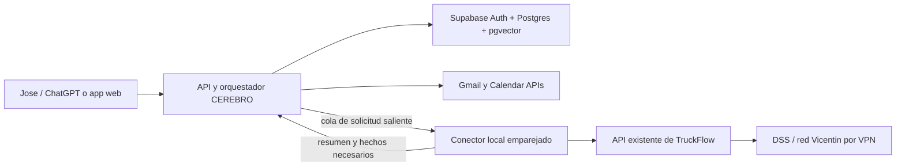

# CEREBRO v1 — arquitectura mínima, datos y primer flujo

**Estado:** diseño funcional y técnico inicial, preparado para revisión. No hay infraestructura desplegada ni cuentas conectadas.

## 1. Objetivo de v1

CEREBRO reúne contexto laboral y personal, registra compromisos con su fuente y prepara un informe al comenzar y terminar la jornada. La primera versión prioriza lectura, clasificación, seguimiento y borradores. Los mensajes enviados, cambios de calendario y otras acciones externas pasan por reglas de autorización explícitas.

El usuario trabaja principalmente con Bimtrazer / Nueva Vicentin, proyectos de programación y automatización, búsqueda laboral y compromisos personales. Sus fuentes iniciales son dos cuentas Gmail, WhatsApp personal, Google Calendar/Meet y TruckFlow local, que consulta un microservicio y DSS por VPN.

## 2. Infraestructura mínima



### Componentes

1. **Interfaz:** reutilizar la aplicación CEREBRO/Next.js existente como shell, luego de auditar su estado actual. No duplicar su auth ni rehacer funciones que ya estén operativas.
2. **Nube:** un proyecto Supabase para Auth y Postgres; habilitar `vector` cuando comience la búsqueda semántica. Storage queda opcional hasta que haya archivos que guardar.
3. **Orquestación:** endpoints autenticados en la app para sincronización y conversación; Edge Functions para tareas cortas y webhooks. Un proceso programado dispara la sincronización matinal y el resumen de cierre. Mantener claves de Google y secretos solo en servidor.
4. **Conectores SaaS:** OAuth de Google con alcance mínimo para Gmail y Calendar. Empezar leyendo y redactando borradores; enviar correo o crear invitaciones requiere una regla aprobada.
5. **Conector local:** servicio pequeño en una PC o servidor autorizado, que inicia conexiones HTTPS salientes, se empareja con un dispositivo y solo acepta acciones permitidas. Lee la API existente de TruckFlow y devuelve métricas/situación resumida. No abrir DSS a Internet, no copiar sus credenciales a la nube y no retransmitir video.
6. **Sistemas laborales:** tratar TruckFlow como fuente de hechos operativos. Reutilizar sus endpoints y herramientas MCP disponibles después de auditarlos; CEREBRO agrega contexto y seguimiento, no crea otro motor de journeys o anomalías.

### Límite de red

El conector local solo consulta datos necesarios y devuelve estado, conteos, alertas y marcas de tiempo. Las consultas DSS directas quedan dentro de la VPN/red autorizada. En v1 no se permite ejecutar SQL arbitrario, controlar cámaras ni escribir en TruckFlow.

## 3. Modelo de datos inicial

Las tablas son de un solo usuario propietario en v1, pero incluyen `user_id` para aislar filas con RLS y permitir una futura ampliación. Cada elemento capturado guarda fuente, fecha, enlace externo, nivel de sensibilidad y cuándo se sincronizó. Las conclusiones del agente apuntan a evidencia; los hechos operativos y las inferencias se guardan por separado.

| Tabla | Uso |
|---|---|
| `projects` | Bimtrazer/Nueva Vicentin, automatizaciones, proyectos independientes, búsqueda laboral y asuntos personales. Prioridad y estado. |
| `people` | Contactos, nombre normalizado, organización, canales e importancia. |
| `source_accounts` | Cuentas Gmail/Calendar, conector local y futuras fuentes; permisos y cursor de sincronización, nunca tokens en texto plano. |
| `source_items` | Metadatos y texto extraído de correos, eventos, reuniones, mensajes importados y observaciones del conector; referencia al elemento original. |
| `tasks` | Pendientes, responsable, vencimiento, estado, proyecto y enlace a evidencia. |
| `decisions` | Decisiones tomadas en reuniones o conversaciones y su procedencia. |
| `facts` | Memoria validada o inferida, con nivel de confianza, periodo de vigencia y evidencia. |
| `document_chunks` | Fragmentos y embeddings para RAG, solo cuando se active búsqueda vectorial. |
| `agent_runs` | Ejecuciones, fuentes leídas, resultado, errores y consumo para auditoría. |
| `approval_requests` | Aprobaciones para enviar, invitar, modificar o borrar; estado y vencimiento. |
| `connector_devices` | Dispositivos locales emparejados, última actividad y capacidades otorgadas. |

### SQL base (borrador, no ejecutado)

Revisar y convertir en una migración versionada al pasar a implementación. Todas las tablas expuestas llevan RLS; no se entrega `service_role` ni una clave secreta al navegador o al conector.

```sql
create extension if not exists vector with schema extensions;

create table public.projects (
  id uuid primary key default gen_random_uuid(),
  user_id uuid not null references auth.users(id) on delete cascade,
  name text not null,
  area text not null check (area in ('bimtrazer','automation','independent','job_search','personal')),
  status text not null default 'active' check (status in ('active','paused','completed','archived')),
  priority smallint not null default 3 check (priority between 1 and 5),
  description text,
  created_at timestamptz not null default now(),
  updated_at timestamptz not null default now(),
  unique (id, user_id)
);

create table public.people (
  id uuid primary key default gen_random_uuid(),
  user_id uuid not null references auth.users(id) on delete cascade,
  display_name text not null,
  organization text,
  importance smallint not null default 3 check (importance between 1 and 5),
  preferred_channel text,
  created_at timestamptz not null default now(),
  unique (id, user_id)
);

create table public.source_accounts (
  id uuid primary key default gen_random_uuid(),
  user_id uuid not null references auth.users(id) on delete cascade,
  provider text not null check (provider in ('gmail','google_calendar','google_meet','whatsapp_import','truckflow_local')),
  label text not null,
  account_ref text,
  granted_scopes text[] not null default '{}',
  sync_cursor jsonb not null default '{}'::jsonb,
  status text not null default 'pending' check (status in ('pending','active','paused','error','revoked')),
  last_synced_at timestamptz,
  created_at timestamptz not null default now(),
  unique (id, user_id)
);

create table public.source_items (
  id uuid primary key default gen_random_uuid(),
  user_id uuid not null references auth.users(id) on delete cascade,
  source_account_id uuid not null,
  external_id text not null,
  kind text not null check (kind in ('email','calendar_event','meeting_note','whatsapp_message','truckflow_snapshot','file')),
  title text,
  body_text text,
  occurred_at timestamptz,
  captured_at timestamptz not null default now(),
  external_url text,
  sensitivity text not null default 'work' check (sensitivity in ('work','personal','sensitive')),
  metadata jsonb not null default '{}'::jsonb,
  created_at timestamptz not null default now(),
  foreign key (source_account_id, user_id) references public.source_accounts(id, user_id) on delete cascade,
  unique (source_account_id, external_id),
  unique (id, user_id)
);

create table public.tasks (
  id uuid primary key default gen_random_uuid(),
  user_id uuid not null references auth.users(id) on delete cascade,
  project_id uuid,
  owner_person_id uuid,
  title text not null,
  details text,
  status text not null default 'open' check (status in ('open','in_progress','blocked','done','dismissed')),
  priority smallint not null default 3 check (priority between 1 and 5),
  due_at timestamptz,
  follow_up_at timestamptz,
  source_item_id uuid,
  confidence real not null default 1 check (confidence between 0 and 1),
  created_by text not null default 'agent' check (created_by in ('user','agent')),
  created_at timestamptz not null default now(),
  updated_at timestamptz not null default now(),
  foreign key (project_id, user_id) references public.projects(id, user_id),
  foreign key (owner_person_id, user_id) references public.people(id, user_id),
  foreign key (source_item_id, user_id) references public.source_items(id, user_id)
);

create table public.decisions (
  id uuid primary key default gen_random_uuid(),
  user_id uuid not null references auth.users(id) on delete cascade,
  project_id uuid,
  source_item_id uuid,
  summary text not null,
  decided_at timestamptz,
  confidence real not null default 1 check (confidence between 0 and 1),
  created_at timestamptz not null default now(),
  foreign key (project_id, user_id) references public.projects(id, user_id),
  foreign key (source_item_id, user_id) references public.source_items(id, user_id)
);

create table public.facts (
  id uuid primary key default gen_random_uuid(),
  user_id uuid not null references auth.users(id) on delete cascade,
  project_id uuid,
  subject text not null,
  predicate text not null,
  object jsonb not null,
  confidence real not null default 1 check (confidence between 0 and 1),
  valid_from timestamptz,
  valid_until timestamptz,
  source_item_id uuid,
  created_at timestamptz not null default now(),
  foreign key (project_id, user_id) references public.projects(id, user_id),
  foreign key (source_item_id, user_id) references public.source_items(id, user_id)
);

create table public.document_chunks (
  id uuid primary key default gen_random_uuid(),
  user_id uuid not null references auth.users(id) on delete cascade,
  source_item_id uuid not null,
  chunk_index integer not null,
  content text not null,
  embedding extensions.vector(1536),
  created_at timestamptz not null default now(),
  unique (source_item_id, chunk_index),
  foreign key (source_item_id, user_id) references public.source_items(id, user_id) on delete cascade
);

create table public.agent_runs (
  id uuid primary key default gen_random_uuid(),
  user_id uuid not null references auth.users(id) on delete cascade,
  flow_name text not null,
  status text not null check (status in ('running','succeeded','partial','failed')),
  started_at timestamptz not null default now(),
  finished_at timestamptz,
  inputs jsonb not null default '{}'::jsonb,
  output jsonb not null default '{}'::jsonb,
  error_summary text
);

create table public.approval_requests (
  id uuid primary key default gen_random_uuid(),
  user_id uuid not null references auth.users(id) on delete cascade,
  action_type text not null check (action_type in ('send_email','send_message','create_invitation','modify_calendar','delete_data')),
  target jsonb not null,
  payload jsonb not null,
  status text not null default 'pending' check (status in ('pending','approved','rejected','expired','executed')),
  requested_at timestamptz not null default now(),
  expires_at timestamptz,
  decided_at timestamptz,
  executed_at timestamptz
);

create table public.connector_devices (
  id uuid primary key default gen_random_uuid(),
  user_id uuid not null references auth.users(id) on delete cascade,
  name text not null,
  capabilities text[] not null default '{}',
  status text not null default 'paired' check (status in ('paired','paused','revoked')),
  last_seen_at timestamptz,
  created_at timestamptz not null default now()
);

create index tasks_user_due_idx on public.tasks(user_id, due_at) where status in ('open','in_progress','blocked');
create index items_user_occurred_idx on public.source_items(user_id, occurred_at desc);
create index facts_user_subject_idx on public.facts(user_id, subject, predicate);

-- Habilitar RLS y políticas explícitas en cada tabla de public.
do $$
declare t text;
begin
  foreach t in array array['projects','people','source_accounts','source_items','tasks','decisions','facts','document_chunks','agent_runs','approval_requests','connector_devices'] loop
    execute format('alter table public.%I enable row level security', t);
    execute format('revoke all on table public.%I from anon, authenticated', t);
    execute format('grant select, insert, update, delete on table public.%I to authenticated', t);
    execute format('create policy %I on public.%I for select to authenticated using ((select auth.uid()) = user_id)', t || '_select_own', t);
    execute format('create policy %I on public.%I for insert to authenticated with check ((select auth.uid()) = user_id)', t || '_insert_own', t);
    execute format('create policy %I on public.%I for update to authenticated using ((select auth.uid()) = user_id) with check ((select auth.uid()) = user_id)', t || '_update_own', t);
    execute format('create policy %I on public.%I for delete to authenticated using ((select auth.uid()) = user_id)', t || '_delete_own', t);
  end loop;
end $$;
```

**Notas para convertirlo a migración:** las referencias compuestas evitan asociar tareas, decisiones, hechos o fragmentos de otro usuario; las relaciones importantes restringen el borrado hasta que se haga una eliminación controlada. Ajustar dimensión del embedding al modelo elegido. Aplicar RLS con pruebas de dos usuarios antes de conectar datos reales. El acceso Data API a tablas nuevas debe habilitarse deliberadamente según los ajustes vigentes del proyecto.

### Datos que no deben persistirse como texto plano

- Tokens OAuth, contraseñas DSS/TruckFlow, claves de API y secretos del conector.
- Contenido de correos o WhatsApp que no haga falta para una tarea. Definir retención por fuente y permitir borrar una fuente y sus fragmentos.
- Datos personales sensibles en índices semánticos compartidos. En v1, separar `sensitivity`, respetar permisos de cuenta y no mezclar resultados personales en contexto laboral sin necesidad.

## 4. Primer flujo funcional: informe matinal de correo y compromisos

### Entrada y resultado

**Entrada:** Gmail personal y corporativo autorizados, tareas abiertas, vencimientos y reuniones del calendario del día. La jornada base conocida es 09:00–17:00, zona `America/Argentina/Buenos_Aires`; confirmar la hora del resumen de cierre al configurar la automatización. Al principio, el usuario ejecuta “Preparar mi día”; luego se programa al inicio de jornada.

**Resultado:** lista priorizada de correos que necesitan acción, compromisos extraídos con cita al correo, vencimientos y reuniones con antecedentes disponibles. El flujo crea tareas sugeridas o guarda tareas con confianza alta; los casos ambiguos aparecen como pregunta. No envía respuestas ni invitaciones.

### Pasos

1. Obtener mensajes nuevos desde el cursor de cada cuenta Gmail, usando OAuth de solo lectura y una ventana/cursor incremental.
2. Normalizar metadatos y extraer texto; evitar duplicados con `(source_account_id, external_id)`.
3. Clasificar tema, proyecto, personas, pedido, plazo y necesidad de respuesta. Conservar el enlace y fragmento probatorio.
4. Registrar `source_items`; relacionar contra proyectos y personas existentes. No asumir identidades cuando haya ambigüedad.
5. Detectar compromisos. Crear tarea cuando la evidencia sea clara; usar `confidence` y conservar el origen. Si falta responsable o fecha, dejarlo explícito como dato desconocido.
6. Calcular prioridad usando urgencia/vencimiento, proyecto prioritario, importancia del contacto y jornada laboral. Mostrar motivo breve y evidencia.
7. Entregar el informe con acciones propuestas y enlaces directos a Gmail/Calendar.
8. En cierre del día, resumir avances y pendientes; pedir confirmación solo para corregir o completar datos que cambian una acción externa.

### Reglas de autonomía v1

| Acción | Regla inicial |
|---|---|
| Leer, clasificar y resumir correo | Automático después de autorizar las cuentas. |
| Crear tareas y recordatorios propios | Automático; marcar origen y permitir deshacer/editar. |
| Proponer respuesta | Guardar como borrador; no enviar. |
| Seguimiento sin respuesta | Alertar y preparar borrador según importancia y contexto. |
| Enviar correo, WhatsApp o invitación | Aprobación en v1; automatización posterior solo con regla concreta por contacto, tipo de mensaje y límites. |
| Leer WhatsApp personal | No asumir API ni acceso continuo. Empezar mediante exportación/compartición explícita o integración autorizada disponible; confirmar límites antes de activarlo. |
| Leer TruckFlow | Solo lectura por conector local; inicialmente incluir en informe bajo demanda o con snapshot programado. |

## 5. RAG, MCP, APIs y A2A

- **RAG:** arrancar con relaciones SQL y búsqueda por texto; añadir embeddings en `document_chunks` cuando existan documentos/correos relevantes y haya necesidad demostrada. Filtrar siempre por `user_id`, sensibilidad y permisos antes de ranking vectorial.
- **MCP:** interfaz para herramientas con nombres/capacidades acotadas, por ejemplo `list_open_tasks`, `get_plant_snapshot`, `search_project_history`. Las herramientas TruckFlow existentes se integran después de una revisión de permisos y contratos.
- **APIs:** Gmail, Calendar y conector local mediante OAuth/API con alcance mínimo. Cada integración se puede pausar y revocar.
- **A2A:** fuera de v1. Un solo orquestador; separar agentes cuando haya dominios con tareas, permisos y operación independientes.

## 6. Secuencia de implementación

1. **Auditar el proyecto actual:** confirmar Next.js, auth, Supabase existente, esquema, endpoints, reglas RLS y qué MCP de TruckFlow ya funciona. No sobrescribir lo existente.
2. **Preparar la base:** definir políticas de retención y sensibilidad; convertir el esquema en migraciones limpias; habilitar RLS y probar aislamiento entre usuarios.
3. **Memoria manual:** cargar proyectos, contactos prioritarios, tareas abiertas y decisiones de contexto con origen y fechas.
4. **Gmail de solo lectura:** OAuth mínimo, sincronización incremental idempotente, deduplicación y clasificación con enlaces a fuente.
5. **Informe matinal/cierre:** generar borrador, corregir falsos positivos y medir tareas útiles, tareas duplicadas y compromisos omitidos.
6. **Google Calendar y aprobaciones:** sumar agenda; crear una bandeja de aprobación con auditoría antes de enviar o invitar.
7. **Conector local:** emparejamiento, health check y snapshot solo lectura de TruckFlow. Mantener credenciales DSS localmente.
8. **WhatsApp y Meet:** evaluar vías permitidas y consentimiento; incorporar capturas/transcripciones con retención explícita.
9. **Automatización por reglas:** habilitar contactos y categorías específicas tras observar precisión suficiente; registrar cada acción y ofrecer revocación.

## 7. Decisiones pendientes para la implementación

No bloquean el diseño, pero hacen falta antes de conectar datos reales: las dos direcciones Gmail y roles de cada una; los horarios exactos de inicio/cierre e informes; lista inicial de proyectos/contactos prioritarios; política de retención de mensajes; modelo de embeddings y proveedor; máquina/red donde vivirá el conector; y definición de condiciones para contactos autorizados a envío automático.

## 8. Auditoría de preparación del proyecto existente

- **Repositorio:** `josecanaya/growslanding`; la app web está en `apps/web`, usa Next.js, Supabase Auth y Prisma. El diseño se integra en esa app sin tocar `apps/landing`.
- **Bridge existente:** `grows_bridge_devices` y `grows_bridge_jobs` implementan un worker local para tareas del canvas Grows. No reutilizarlo para correo ni TruckFlow: sus permisos y modelo de datos son distintos. El conector CEREBRO necesita capacidades independientes y explícitas.
- **Supabase:** el proyecto `GROWS` (ref `rpzaihmpdcktpqkycidt`) aparece `INACTIVE`. Las consultas MCP a tablas y migraciones devuelven `INVALID_ARGUMENT`, por lo que no se confirmó el esquema vivo ni se aplicó SQL. Antes de desplegar, restaurar el proyecto y repetir la auditoría de tablas, migraciones, RLS y funciones expuestas. La restauración puede tener implicaciones de costo según el plan; no se hizo.
- **Google:** el flujo necesita OAuth configurado para las cuentas personal y corporativa; no se encontró un cliente OAuth listo para esta implementación. Mantener Gmail en solo lectura al principio.
- **Red local:** no hay un host de conector emparejado en esta sesión. La app no debe iniciar conexiones entrantes a la red Vicentin ni enviar credenciales DSS a la nube.
- **Alcance seguro de primera entrega:** la interfaz y el proceso deben poder probarse con datos ficticios; importar correos reales solo después de activar Supabase y completar OAuth. WhatsApp, Meet y TruckFlow quedan como conectores separados posteriores.

### Criterios para declarar CEREBRO v1 operativo

1. Proyecto Supabase activo y esquema comprobado contra las tablas/migraciones vivas.
2. RLS probado con dos identidades distintas; ninguna puede leer los datos de la otra.
3. OAuth de Gmail conectado para las cuentas autorizadas con lectura limitada; deduplicación y cursor incremental verificados.
4. Informe diario generado sobre correos de prueba, con evidencia, enlaces, prioridad explicada y sin enviar mensajes.
5. Conector local emparejado con credencial rotatoria, capacidades de solo lectura y prueba de desconexión/revocación.
6. Aprobaciones y auditoría verificadas antes de habilitar cualquier envío o cambio de calendario.

## Fuentes de implementación consultadas

- Supabase Row Level Security: https://supabase.com/docs/guides/database/postgres/row-level-security
- Supabase changelog: nuevas tablas ya no se exponen automáticamente por Data API para proyectos nuevos desde el 30 de mayo de 2026; el cambio se aplica a todos los proyectos el 30 de octubre de 2026: https://supabase.com/changelog/45329-breaking-change-tables-not-exposed-to-data-and-graphql-api-automatically
- Supabase changelog: actualización de TLS anunciada el 12 de octubre de 2026, con desactivación prevista no antes del 10 de noviembre de 2026: https://supabase.com/changelog/cbc-tls-ciphers-deprecated
